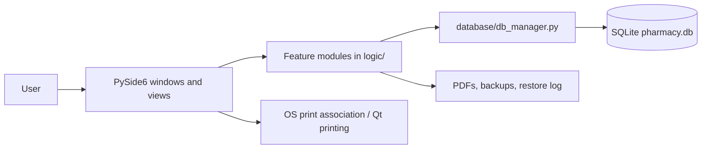
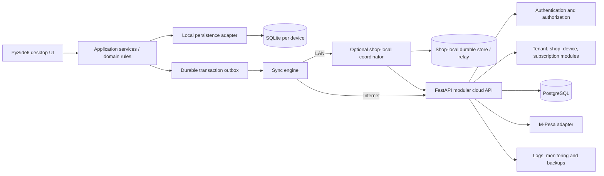

# Architecture: current system and target direction

## Status and scope

The existing PySide6 application remains the desktop client and keeps SQLite for local workflows. Stage 3 adds a durable local outbox, batch-level inventory, bounded offline authorization, device-authenticated cloud sync, and an optional SQLite-backed shop LAN coordinator. The FastAPI/PostgreSQL backend accepts idempotent device events and serves a change feed, including audited cloud replay of returns with stable sale-line and batch references. This is a functional foundation, not a production deployment: operator provisioning, TLS deployment, conflict-resolution operations, and monitoring/backup drills remain incomplete.

## Current architecture

`main.py` initializes the schema and opens `LoginWindow`. The UI imports feature modules directly. Modules such as sales, inventory, customers, suppliers, reports, and auth each open short-lived SQLite connections through `database.db_manager.get_connection()`. The schema is in `database/schema.sql`; startup migrations are inline in `database/db_manager.py`. `logic/` contains feature logic and document, printing, audit, security, and backup helpers. `ui/main_window.py` builds navigation and hides some pages for cashiers. These are useful seams for incremental extraction, but UI, business rules, and storage are not separated by formal interfaces.

## Workflows observed in source

- Login, local user management, admin/cashier views, settings, and audit log.
- Medicine CRUD, barcode lookup/label generation, stock adjustments, low-stock and expiry alerts. The schema stores a single `batch_no` and `expiry_date` on each medicine record.
- Sales/POS, customer credit (udhaar), partial customer payments, returns, supplier purchase intake/payables, and payment records.
- Daily/monthly sales, profit/loss, expiry, dead-stock, best-seller, controlled-substance, customer credit and payable reports; PDF/Excel outputs.
- Invoice and thermal receipt generation/printing.
- Manual/automatic SQLite file backups and restore.

These are source-level observations. Desktop runtime behavior is not verified in this environment.

## Target architecture (proposed, not implemented)

Keep a modular application rather than splitting into microservices:

1. **Desktop UI:** PySide6 screens and user interaction. Preserve familiar workflows. Call application services rather than issuing SQL from views.
2. **Domain/application layer:** pharmacy rules and use cases independent of Qt, SQLite, HTTP, and PostgreSQL. Monetary arithmetic, stock movements, sale/return invariants, and authorization checks belong here or at the enforcing service boundary.
3. **Device-local persistence:** SQLite remains the offline source for that computer's accepted work. Use explicit, numbered, transactional migrations and SQLite backup API. Do not replace desktop SQLite with PostgreSQL.
4. **Outbox and sync engine:** each committed local business transaction appends durable, uniquely identified events in the same SQLite transaction. Delivery is at least once; receivers are idempotent. Track attempts, acknowledgments, and conflicts. Never report synchronization complete before server acknowledgment.
5. **Shop LAN coordination (optional):** `network/shop_server.py` owns a private SQLite database and serializes accepted stock events. Terminals communicate over authenticated HTTP and never share/open that database file. A single-computer shop can sync directly to cloud.
6. **Cloud backend:** one FastAPI modular monolith backed by PostgreSQL. Modules own tenant/shop/device membership, business replicas, sync endpoints, subscriptions/licensing, and payment callbacks. PostgreSQL is the central cloud store only.
7. **Authorization:** authenticate users/devices at API boundaries. Resolve tenant/shop scope from verified memberships and device registration; do not accept client-supplied IDs or role claims as authorization. Enforce scope in each query and use database constraints as a second boundary.
8. **External integrations and operations:** M-Pesa is a server-side adapter with callback validation, idempotency and reconciliation. Subscription state must not silently prevent essential offline work. Monitoring, redacted structured logs, encrypted backups, and restore drills are platform responsibilities.

### Offline and synchronization assumptions to validate

- Commit a transaction locally before it enters the outbox.
- Give each event an immutable ID, device ID, shop scope, schema version, and creation time. The server binds authenticated device identity to its registered shop and tenant.
- Retries may deliver duplicates. Receivers deduplicate by event ID and preserve the original result.
- Sales and payment records are append-oriented. Corrections use explicit reversal/return records rather than rewriting acknowledged history.
- A standalone terminal has only its own stock view. If it is disconnected from both cloud and the shop coordinator, its local sale is recorded and flagged as potentially inconsistent; after recovery, the server accepts or flags it for review based on current stock.
- Product and batch changes need deterministic ownership/version rules. Last-write-wins is not suitable for money or stock movements.
- Store UTC instants for synchronization/audit; use the configured shop timezone for business dates (Kenya default `Africa/Nairobi`).

## Stage 3 implementation and operating boundary

- The local migration ledger creates distinct batches, stock movements, purchases, payment rows, offline authorization cache, sync outbox, downloaded changes, checkpoints, and conflicts. Sales, payment snapshots, stock movement and outbox insertion commit in one `BEGIN IMMEDIATE` transaction.
- Offline access after successful cloud login lasts at most 72 hours. Cloud membership revocation may take effect locally only after that cached authorization expires or the device reconnects; this is the explicit outage policy. Cloud access uses a device credential stored through the operating system keyring.
- Configure cloud sync in the login flow after installing the `keyring` dependency. The cloud API URL must be HTTPS in production. Sync retries are at least once; event IDs and transaction IDs remain stable across retry, and the server stores the prior result.
- For LAN deployment, initialize a trusted coordinator database from one shop's verified local database and provision all terminals from the same baseline before they start transacting. The current server seeds batch balances and acknowledges pending baseline events; it does not yet distribute a complete client database image. Do not connect independent legacy databases as if their batch IDs already match.
- If a terminal loses the LAN coordinator, sales can continue against its local SQLite copy, but the UI explicitly labels stock as potentially inconsistent. When connectivity returns, stale/overselling transactions become visible conflicts; an administrator must reconcile them. This does not provide guaranteed multi-terminal stock availability during a network partition.
- LAN authentication uses HMAC request signing with registered per-device credentials, a 5-minute timestamp window, and a separate enrollment secret. Use a private trusted network and a TLS reverse proxy for deployments that cross untrusted links. Protect the coordinator host and database file.
- Back up the coordinator while it is stopped, or use SQLite's online backup API. On host failure, restore the last verified coordinator backup and reconcile terminal outboxes against its event history; if no valid backup exists, provision a new coordinator from the authoritative terminal, preserve all terminal databases, and reconcile conflicts before resuming coordinated sales.

## Incremental migration path

1. Preserve and baseline the desktop app; add tests around current workflows.
2. Introduce a migration ledger, SQLite backup API, domain/service boundaries, and append-only stock/payment events without removing current screens.
3. Add batch/lot inventory and stable IDs through additive migrations and reconciliation reports; keep legacy records readable during transition.
4. Define local outbox, idempotent sync contract, device enrollment, and conflict policy; exercise with test data before enabling cloud writes.
5. Build the FastAPI/PostgreSQL modular backend and tenant authorization, with migration and restore drills.
6. Pilot one tenant/shop, then LAN multi-device support, M-Pesa, licensing, and monitoring behind controlled rollout flags.

Every schema conversion requires a tested backup, restore rehearsal, migration dry run, and reconciliation of sales totals, balances, and stock before rollout.

## Current limitations

- Cloud-return event replay is not implemented; return events stay in the cloud sync review queue and must be reconciled by an authorized operator.
- LAN terminal provisioning still requires a trusted identical initial batch/catalogue baseline; there is no signed snapshot installer or automatic full-catalogue bootstrap from the LAN coordinator yet.
- Conflict UI records the operator's reconciliation note but does not automatically create a compensating stock movement. The operator must perform the business correction separately and record the note.
- Retail sale tenders remain separate from subscription billing. The backend has a Daraja STK subscription integration foundation; sandbox-to-production approval and callback-source authenticity controls remain deployment/provider concerns.
- Login and roles are local. UI page visibility is not a server-side security boundary; business functions generally do not receive an actor or enforce role authorization themselves.
- Cloud authentication, tenant isolation, device enrollment, subscription checks, sync event authorization, and server-side audit events are implemented; offline authorization is locally cached for at most 72 hours.
- Subscription billing, Daraja callback/status reconciliation, platform metadata administration, tenant exports, and support grants are implemented as API endpoints. There is no graphical platform administration console; see `backend/OPERATIONS.md` for deployment and legal prerequisites.
- Backend integration tests run against a disposable PostgreSQL database. The desktop runtime remains unverified in this Linux environment because its declared UI dependency is not installed here.
