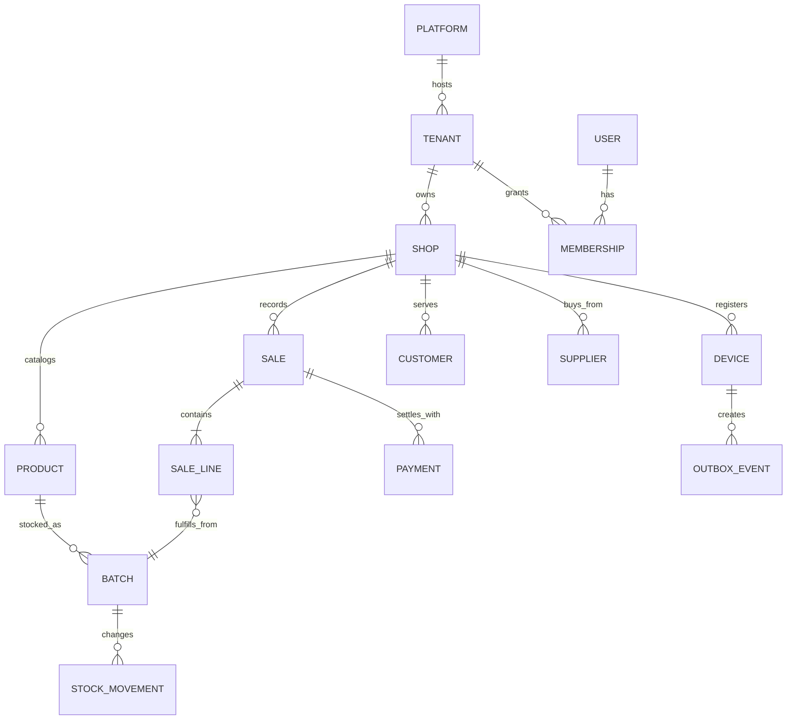

# Data model and tenancy plan

## Existing SQLite model

The current schema is defined in `database/schema.sql`; primary keys are SQLite autoincrement integers. It is a single-shop model without tenant, shop, device, membership, or synchronization records.

| Entity | Current ownership and relationships |
| --- | --- |
| `users` | Local login and role (`admin` or `cashier`). |
| `suppliers` | Local supplier directory and current payable balance. |
| `customers` | Local customer directory and current credit balance. |
| `medicines` | Catalog, stock quantity, price, supplier reference, one batch and expiry value. |
| `sales` | Invoice, customer, cashier, totals and payment summary. |
| `sale_items` | Medicine, quantity, unit price, subtotal, returned quantity. |
| `customer_payments` | Customer credit repayments and recording user. |
| `supplier_payments` | Supplier payments and recording user. |
| `sale_returns` | Return against sale and line, quantity, refund and processor. |
| `audit_log` | Local action, actor snapshot, details and timestamp. |
| `backup_log` | Backup filename, date, size and type. |
| `settings` | Local key/value configuration. |

Foreign keys are enabled per connection. Monetary values use SQLite `REAL`; balances are stored as mutable aggregates alongside transaction records. Sales keep a summary `payment_method` and `amount_paid`, while repayments are separate rows. There is no general payment allocation ledger or M-Pesa transaction entity.

## Cloud hierarchy implemented in Stage 2

Platform is the service operator scope. A tenant is an independent pharmacy business. A tenant owns one or more shops. Registered devices belong to one shop at a time and have revocable credentials. Users have explicit memberships scoped to a tenant and optionally a shop, with role/permission grants. A user may belong to multiple tenants and shops.

## Cloud entities and ownership

| Entity | Scope / key relationships | Notes |
| --- | --- | --- |
| `tenants` | Platform-owned; tenant is root of business ownership | Stable UUID; status and plan references. |
| `shops` | `tenant_id` required | Stable UUID; timezone and display/currency settings; shop-level operational scope. |
| `users` | Platform identity | No implicit access to business rows. |
| `memberships` | `tenant_id`, optional `shop_id`, `user_id` | Explicit active grants and role/permission set. Role alone does not define scope. |
| `devices` | `tenant_id`, `shop_id` required | Server-issued ID/credential metadata, status, last-seen and revocation. Never trust a submitted ID without credential verification. |
| `medicines` | Tenant catalog | UUID catalog records; shop stock lives in separately scoped batches. |
| `medicine_batches` | `tenant_id`, `shop_id`, `medicine_id` | Batch number, expiry, purchase cost, selling price, and on-hand quantity. Batch owns expiry and cost. |
| `stock_movements` | Tenant/shop and optional device; batch reference | Immutable receipt, sale, return, adjustment, transfer, expiry or reversal with actor and source event ID. |
| `customers`, `suppliers` | Tenant/shop scope policy | Decide tenant-wide versus shop-owned records before migration. |
| `sales`, `sale_items`, `sale_returns` | Tenant/shop, cashier membership, device, stable IDs | Sale lines retain price/cost snapshots and returned quantity. Cloud returns are append-only compensation records linked to the original sale line and batch. |
| `payments` | Tenant/shop and sale/customer/supplier as applicable | Retail payments are separate from the subscription payment ledger. Daraja subscription attempts and provider references are modeled in the backend. |
| `sync_events` | Tenant and optional shop/device scope | Durable desktop outbox and device sync APIs use stable event IDs and idempotent replay; unresolved business conflicts require operator reconciliation. |
| `subscription_plans`, `tenant_subscriptions`, `subscription_payments`, `daraja_attempts` | Tenant scope | Plan, effective period, status, limits, subscription billing ledger, and Daraja references. Tenant expiry preserves permitted reads/export and local data. |
| `audit_events` | Tenant plus optional shop/device/actor | Append-only, redacted, server-created audit for cloud operations. |

Every cloud business row must carry `tenant_id`; shop operations also carry `shop_id`. For dependent rows, enforce composite ownership constraints so a reference cannot cross scopes. Derive query scope from authenticated membership. Tenant and shop IDs from request payloads are selectors to validate, never proof of authority.

The cloud schema/API and local SQLite schema implement tenant, shop, identity, membership, role/permission, devices, subscription billing, medicine, batch, supplier, purchase, sale, payment, return, stock movement, audit, and sync foundations. An offline return is reconciled only against its correlated cloud sale line and batch; refund and credit arithmetic are checked before applying stock, customer balance, audit, and inbox records in one transaction. PostgreSQL row-level security supplements explicit API authorization.

## Stage 3 local offline model

The additive SQLite migration in `database/db_manager.py` preserves existing integer row IDs for desktop screens while introducing stable UUIDs for devices, batches, transactions, and events:

| Local tables / columns | Purpose |
| --- | --- |
| `sync_identity` | Explicit tenant, shop, and device binding; coordination mode and endpoint; last sync/error state. A new installation starts unlinked and standalone. |
| `medicine_batches` | Distinct batch number, expiry, on-hand quantity, cost, sale price, source, and optional cloud UUID. Legacy medicine quantity is retained as a compatibility summary. |
| `stock_movements` | Append-oriented stock receipt, sale, return, and adjustment changes with transaction and batch references. |
| `local_purchases`, `local_purchase_items`, `local_payments` | Purchase and payment snapshots with transaction IDs. |
| `sync_outbox` | Immutable event ID, transaction ID, tenant/shop/device scope, event payload, retry schedule, delivery status, and acknowledgment. |
| `downloaded_changes`, `sync_checkpoints` | Idempotent remote change storage and resumable cloud/LAN cursors. |
| `sync_conflicts` | Unresolved stock/catalogue discrepancies and administrator reconciliation note. |
| `offline_auth_cache` | Locally salted verifier, selected tenant/shop, permissions, last online login, and explicit 72-hour authorization expiry. |

Sales and returns commit the transaction header, item/batch allocations, payment, stock movement, and outbox event atomically. Completed lines snapshot their sale price and purchase cost. Cloud event replay preserves those snapshots; stale stock is recorded as a conflict. LAN accepts one event at a time under a serialized SQLite write transaction and deduplicates by event UUID.

The coordinator currently has no full-catalogue image endpoint. LAN terminals must share a verified initial catalogue/batch baseline. Independent terminal databases with unrelated batch IDs must not be joined to the same coordinator without a migration/reconciliation procedure. Existing return events without stable cloud sale-line, batch, or actor IDs remain conflicts for operator review.

## Stable identity and local/cloud mapping

Current integer IDs are local to a database and cannot safely identify a record across devices. Add stable UUIDs before synchronization. Keep existing integer primary keys for local foreign keys during transition; add unique stable IDs and an explicit mapping/reconciliation step. Do not reuse primary keys as globally unique identities. Outbox and entity IDs must remain stable across retry and restore.

## Migration and reconciliation

- Establish versioned, ordered migrations with a schema-version table.
- Take a SQLite online backup before each migration; verify integrity and perform restore rehearsal before rollout.
- Add stable IDs and tenant/shop ownership in additive steps. During a single-shop pilot, map existing business rows only to the explicitly enrolled tenant/shop after owner confirmation.
- Convert medicine-level batch fields into one opening lot per medicine, preserving old batch/expiry text and quantity in a migration report. Do not imply historical aggregate quantities have known batch composition if old receipts overwrote it.
- Reconcile product quantities against opening lots, sale/return/purchase history, customer credit, supplier payable, and sales totals. Report mismatches; do not silently force balances.
- Convert currency to integer minor units with explicit currency codes and a controlled rounding/reconciliation report; do not convert floats without review.
- Keep rollback possible via a tested pre-migration database and documented restore procedure. Never destructively rewrite the only copy.

## Unresolved model choices

Confirm whether catalog, customer, and supplier records are tenant-wide or shop-specific; whether stock can transfer between shops; how batch allocation/FEFO exceptions work; and what transaction history is retained. These choices affect constraints and sync conflict rules and must be decided before cloud migrations.
